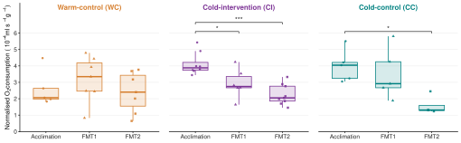

# Physiological measurements

## Respirometry

```{r load_data_resp}
load("data/data_03122025.Rdata")
respirometry_resp2 <- read_excel("data/respirometry_resp2.xlsx")
```

```{r dataframe_modify, warning=FALSE}
respirometry_resp2$individual <- as.factor(respirometry_resp2$individual)
respirometry_resp2$cage <- as.factor(respirometry_resp2$cage)
respirometry_resp2$time_point <- as.factor(respirometry_resp2$time_point)
respirometry_resp2$type <- as.factor(respirometry_resp2$type)
respirometry_resp2$population <- as.factor(respirometry_resp2$population)
respirometry_resp2$QC_normalized <- as.numeric(respirometry_resp2$QC_normalized)
respirometry_resp2$r2 <- as.numeric(respirometry_resp2$r2)


#Filter NA values
respirometry_resp2<-respirometry_resp2 %>%
  filter(QC_normalized!="NA")
```


### Exclusions and sample sizes

Oxygen consumption is expressed as mass-specific rate in ml O2 s^-1 g^-1 (`QC_normalized`; "s" = seconds). The models below do not apply a generic R2 > 0.8 cut-off: they use the hard-coded exclusions listed here (the same ones as `manuscript_figures/figure4/make_figure4.R`). Each rule is documented in the table; which observations are excluded has not been changed.

```{r resp_exclusions, warning=FALSE}
# Exclusion rules used throughout this file (kept identical to the filters in every model chunk):
#  weight 5.19, 5.91, 5.03 : measurements of the acclimation time-point flagged as outliers/low quality (weight used as identifier)
#  r2 0.808, 0.728         : low r2 / animal movement (0.808 is >0.8 but was excluded as an outlier; 0.728 is <0.8)
#  QC_normalized 0.000036  : r2 low (0.698)
#  cages Cold_17, Cold_3, Cold_6, Cold_9, Hot_2, Hot_8 : cages with low-quality measurements; the filter removes ALL time-points of the cage
excl_weights <- c(5.19, 5.91, 5.03)
excl_r2      <- c(0.808, 0.728)
excl_qc      <- 0.000036
excl_cages   <- c("Cold_17", "Cold_3", "Cold_6", "Cold_9", "Hot_2", "Hot_8")

resp_flagged <- respirometry_resp2 %>%
  mutate(reason = paste0(
    ifelse(weight %in% excl_weights, "weight rule; ", ""),
    ifelse(r2 %in% excl_r2, "r2 rule (0.808/0.728); ", ""),
    ifelse(QC_normalized == excl_qc, "QC value rule (r2 low); ", ""),
    ifelse(cage %in% excl_cages, "cage rule; ", "")),
    excluded = reason != "")

resp_flagged %>%
  filter(excluded) %>%
  select(individual, cage, type, time_point, weight, r2, QC_normalized, reason) %>%
  arrange(time_point, type, individual) %>%
  as.data.frame() %>% print()

cat("\nRows with measurement (QC_normalized not NA):", nrow(resp_flagged), "\n")
cat("Rows excluded:", sum(resp_flagged$excluded), " retained:", sum(!resp_flagged$excluded), "\n")
cat("Rows with r2 <= 0.8:", sum(resp_flagged$r2 <= 0.8), "(all excluded:", all(resp_flagged$excluded[resp_flagged$r2 <= 0.8]), ")\n")
cat("Rows with r2 > 0.8 excluded by weight/cage/value rules:", sum(resp_flagged$excluded & resp_flagged$r2 > 0.8), "\n")
cat("Rows with r2 > 0.8 retained:", sum(!resp_flagged$excluded & resp_flagged$r2 > 0.8), "\n")
cat("Retained rows with r2 <= 0.8:", sum(!resp_flagged$excluded & resp_flagged$r2 <= 0.8), "\n")
```

```{r resp_sample_sizes}
# Data set used by all models (retained observations)
resp_kept <- resp_flagged %>% filter(!excluded)
stopifnot(nrow(resp_kept) == 56)

cat("Observations per group and time-point (0 = Acclimation, 1 = FMT1, 2 = FMT2):\n")
resp_kept %>% count(type, time_point) %>% pivot_wider(names_from = time_point, values_from = n) %>% as.data.frame() %>% print()
cat("\nIndividuals per group (at least one retained observation):\n")
resp_kept %>% group_by(type) %>% summarise(individuals = n_distinct(individual), observations = n()) %>% as.data.frame() %>% print()
cat("\nIndividuals per group and time-point:\n")
resp_kept %>% group_by(type, time_point) %>% summarise(individuals = n_distinct(individual), .groups = "drop") %>%
  pivot_wider(names_from = time_point, values_from = individuals) %>% as.data.frame() %>% print()
```

```{r resp_helpers}
set.seed(123)  # no random procedure is used in this file; set for safety
# Fixed-effect table of an lme at full precision (estimate, SE, DF, t, p), plus rounded versions for citing in the text
lme_rows <- function(m) {
  tt_ <- as.data.frame(summary(m)$tTable)
  tibble(term = rownames(tt_), estimate = tt_$Value, SE = tt_$Std.Error, DF = tt_$DF, t = tt_[["t-value"]], p = tt_[["p-value"]]) %>%
    mutate(estimate_sci = formatC(estimate, format = "e", digits = 3),
           estimate_4dp = round(estimate, 4), p_sci = formatC(p, format = "e", digits = 3))
}
resp_subset <- function(types = NULL) {
  out <- resp_kept %>% mutate(type = as.character(type)) 
  if (!is.null(types)) out <- out %>% filter(type %in% types)
  out %>% mutate(type = factor(type), time_point = factor(time_point), individual = droplevels(individual))
}
options(width = 200, digits = 7)
```

### Acclimation oxygen consumption

```{r plot}
respirometry_resp2 %>%
  filter(time_point=="0")%>%
  filter(individual!="AH1_2nd_8") %>%
  filter(individual!="LI1_2nd_4") %>%
  filter(individual!="LI1_2nd_3") %>% #lizard doesn't stop moving during the whole measurement, increasing the value and making it and outlier
  filter(individual!="LI1_2nd_10") %>%
  ggplot(aes(x = population, y = QC_normalized, color=population, fill=population, alpha=0.2)) +
    geom_boxplot()+
    geom_jitter() +
      scale_color_manual(name="Population",
          breaks=c("Cold","Warm"),
          labels=c("Cold","Warm"),
          values=c('#008080', "#d57d2c")) +
      scale_fill_manual(name="Population",
          breaks=c("Cold","Warm"),
          labels=c("Cold","Warm"),
          values=c('#00808050', "#d57d2c50"))+
    #geom_text(aes(label = individual), hjust = 0, nudge_x = 0.05) +
    theme(axis.text.x = element_text(angle = 45, vjust = 0.5, hjust=1))+
    geom_signif(
      comparisons = list(c("Cold", "Warm")),
      test = "wilcox.test",
      map_signif_level = FALSE,
      textsize = 3,
      label_format = function(p) paste0("p = ", format(p, digits=3))) +
    theme(legend.position="none",
          panel.background = element_blank(),
          panel.grid.major = element_blank(),
          panel.grid.minor = element_blank())+
    theme_minimal()+
    labs(x = "Population", y= expression("Normalized O"[2]*" consumption (ml s"^-1*" g"^-1*")"))  # units: ml O2 per second per gram (s^-1, not "seg")
```


#### Acclimation: cold vs warm (Wilcoxon test)

```{r acclimation_wilcoxon_excl}
# Version used in the manuscript (p = 0.048): four acclimation individuals excluded
# (AH1_2nd_8, LI1_2nd_3, LI1_2nd_4, LI1_2nd_10; the lizard did not stop moving during the whole measurement)
acc_excl <- c("AH1_2nd_8", "LI1_2nd_4", "LI1_2nd_3", "LI1_2nd_10")
acc_all  <- respirometry_resp2 %>% filter(time_point == "0")
acc_sub  <- acc_all %>% filter(!individual %in% acc_excl)
cat("n per population (4 individuals excluded):\n"); print(table(acc_sub$population))
w1 <- wilcox.test(QC_normalized ~ population, data = acc_sub)
print(w1); cat("W =", w1$statistic, " p =", format(w1$p.value, digits = 6), "\n")
```

```{r acclimation_wilcoxon_all}
# Same test using all acclimation individuals (no exclusions)
cat("n per population (all individuals):\n"); print(table(acc_all$population))
w2 <- wilcox.test(QC_normalized ~ population, data = acc_all)
print(w2); cat("W =", w2$statistic, " p =", format(w2$p.value, digits = 6), "\n")
```

### Time-point oxygen consumption

Oxygen consumption at each time-point and experimental group (Figure 4 of the manuscript). The figure is drawn by `manuscript_figures/figure4/make_figure4.R` (exported with `manuscript_figures/figure4/build_figure4.py`) after excluding low-quality and outlying measurements (the same filters as in the models below). Brackets show significant pairwise differences between time-points within each group, from a linear mixed model with individual as a random effect and Tukey-adjusted post-hoc contrasts (`emmeans`).

```{r plot_1, comment="", message=FALSE, warning=FALSE, results="hide"}
source("manuscript_figures/figure4/make_figure4.R")
```

```{r plot_1_show, echo=FALSE, out.width="100%"}

```

Pairwise contrasts between time-points within each group (Tukey-adjusted):

```{r plot_1_contrasts, comment="", message=FALSE, warning=FALSE}
read_tsv("manuscript_figures/figure4/oxygen_contrasts.tsv", show_col_types = FALSE) %>%
  select(type, contrast, estimate, SE, df, t.ratio, p.value, star) %>%
  tt()
```

### Data modelling 

#### CI from acclimation to post FMT

```{r model_ci, eval=TRUE}
#subset all the wrong measurements
respirometry_resp2_subsetci<-respirometry_resp2%>%
  filter(type!="WC")%>%
  filter(weight!=5.19)%>%
  filter(weight!=5.91)%>%
  filter(weight!=5.03)%>%
  filter(r2!=0.808)%>%
  filter(QC_normalized!=0.000036) %>% #r2 low
  filter(r2!=0.728) %>%
  filter(cage!="Cold_17") %>%
  filter(cage!="Cold_3") %>%
  filter(cage!="Cold_6") %>%
  filter(cage!="Cold_9") %>%
  filter(cage!="Hot_2") %>%
  filter(cage!="Hot_8")%>%
  filter(type=="CI")

#Create linear model formula
model <- lme(fixed = QC_normalized ~  time_point, data = respirometry_resp2_subsetci,
             random = ~ 1 | individual)

#Print the model summary
summary(model)
MuMIn::r.squaredGLMM(model)
```

#### CC from acclimation to post FMT

```{r model_cc, eval=TRUE}
#subset all the wrong measurements
respirometry_resp2_subsetcc<-respirometry_resp2%>%
  filter(type!="WC")%>%
  filter(weight!=5.19)%>%
  filter(weight!=5.91)%>%
  filter(weight!=5.03)%>%
  filter(r2!=0.808)%>%
  filter(QC_normalized!=0.000036) %>% #r2 low
  filter(r2!=0.728) %>%
  filter(cage!="Cold_17") %>%
  filter(cage!="Cold_3") %>%
  filter(cage!="Cold_6") %>%
  filter(cage!="Cold_9") %>%
  filter(cage!="Hot_2") %>%
  filter(cage!="Hot_8")%>%
  filter(type=="CC")

#Create linear model formula
model <- lme(fixed = QC_normalized ~  time_point, data = respirometry_resp2_subsetcc,
             random = ~ 1 | individual)

#Print the model summary
summary(model)
MuMIn::r.squaredGLMM(model)
```


#### WC from acclimation to post FMT

```{r model_wc, eval=TRUE}
#subset all the wrong measurements
respirometry_resp2_subsetwc<-respirometry_resp2%>%
  filter(weight!=5.19)%>%
  filter(weight!=5.91)%>%
  filter(weight!=5.03)%>%
  filter(r2!=0.808)%>%
  filter(QC_normalized!=0.000036) %>% #r2 low
  filter(r2!=0.728) %>%
  filter(cage!="Cold_17") %>%
  filter(cage!="Cold_3") %>%
  filter(cage!="Cold_6") %>%
  filter(cage!="Cold_9") %>%
  filter(cage!="Hot_2") %>%
  filter(cage!="Hot_8")%>%
  filter(type=="WC")

#Create linear model formula
model <- lme(fixed = QC_normalized ~  time_point, data = respirometry_resp2_subsetwc,
             random = ~ 1 | individual)

#Print the model summary
summary(model)
MuMIn::r.squaredGLMM(model)
```


#### S3-S5: per-group models, full precision and Tukey contrasts

```{r lme_tables_s3_s5}
# Supplementary Tables S3 (CI), S4 (CC), S5 (WC): lme(QC_normalized ~ time_point, random = ~1|individual) per group.
# The text quotes these unadjusted lme p-values; Methods/Fig. 4 legend refer to Tukey-adjusted emmeans contrasts (next chunk).
# time_point1 = FMT1 - Acclimation, time_point2 = FMT2 - Acclimation (units ml O2 s^-1 g^-1)
group_models <- purrr::map(set_names(c("CI", "CC", "WC")), function(g)
  lme(QC_normalized ~ time_point, random = ~ 1 | individual, data = resp_subset(g)))
imap_dfr(group_models, ~ lme_rows(.x) %>% mutate(group = .y, .before = 1)) %>% as.data.frame() %>% print(digits = 6)
```

```{r emmeans_tukey_s3_s5, message=FALSE}
# Tukey-adjusted pairwise contrasts within each group (the values behind Fig. 4 brackets)
imap_dfr(group_models, function(m, g)
  as.data.frame(emmeans::emmeans(m, pairwise ~ time_point, adjust = "tukey")$contrasts) %>% mutate(group = g, .before = 1)) %>%
  print(digits = 6)
```


#### CC vs CI Raw data modelling (LMM)

```{r model, eval=TRUE}
#subset all the wrong measurements
respirometry_resp2_subset<-respirometry_resp2%>%
  filter(type!="WC")%>%
  filter(weight!=5.19)%>%
  filter(weight!=5.91)%>%
  filter(weight!=5.03)%>%
  filter(r2!=0.808)%>%
  filter(QC_normalized!=0.000036) %>% #r2 low
  filter(r2!=0.728) %>%
  filter(cage!="Cold_17") %>%
  filter(cage!="Cold_3") %>%
  filter(cage!="Cold_6") %>%
  filter(cage!="Cold_9") %>%
  filter(cage!="Hot_2") %>%
  filter(cage!="Hot_8")

#Create linear model formula
model <- lme(fixed = QC_normalized ~  time_point+type, data = respirometry_resp2_subset,
             random = ~ 1 | individual)

#Print the model summary
summary(model)
MuMIn::r.squaredGLMM(model)
```

```{r lme_table_s6}
# Supplementary Table S6: additive model (no interaction), CC vs CI; reference level of type = CC
m_s6 <- lme(QC_normalized ~ time_point + type, random = ~ 1 | individual, data = resp_subset(c("CC", "CI")))
lme_rows(m_s6) %>% as.data.frame() %>% print(digits = 6)
```


#### CI vs WC Raw data modelling (LMM)

```{r model_2, eval=TRUE}
#subset all the wrong measurements; keep only CI and WC (CC was previously NOT filtered out, so the old Table S7 was the 3-group model)
respirometry_resp2_subset<-respirometry_resp2%>%
  filter(type!="CC")%>%
  filter(weight!=5.19)%>%
  filter(weight!=5.91)%>%
  filter(weight!=5.03)%>%
  filter(r2!=0.808)%>%
  filter(QC_normalized!=0.000036) %>% #r2 low
  filter(r2!=0.728) %>%
  filter(cage!="Cold_17") %>%
  filter(cage!="Cold_3") %>%
  filter(cage!="Cold_6") %>%
  filter(cage!="Cold_9") %>%
  filter(cage!="Hot_2") %>%
  filter(cage!="Hot_8") %>%
  droplevels()  # drop the empty CC level so that the coefficient is typeWC (reference = CI)

#Create linear model formula
model <- lme(fixed = QC_normalized ~  time_point+type, data = respirometry_resp2_subset,
             random = ~ 1 | individual)

#Print the model summary
summary(model)
MuMIn::r.squaredGLMM(model)
```

```{r lme_table_s7}
# Supplementary Table S7 at full precision (additive model, CI vs WC; reference level of type = CI)
m_s7 <- lme(QC_normalized ~ time_point + type, random = ~ 1 | individual, data = resp_subset(c("CI", "WC")))
stopifnot(isTRUE(all.equal(fixef(m_s7), fixef(model))))
lme_rows(m_s7) %>% as.data.frame() %>% print(digits = 6)
```

#### Group x time-point interaction models

```{r model_interaction}
# Tests whether the change over time differs between groups ("decreased earlier in the intervention group")
# CC vs CI (reference CC) and CI vs WC (reference CI): lme(QC_normalized ~ time_point * type, random = ~1|individual)
# Fitted with REML for coefficients; the omnibus interaction test is a Wald F test from anova() (marginal).
int_models <- list("CC vs CI" = c("CC", "CI"), "CI vs WC" = c("CI", "WC")) %>%
  purrr::map(~ lme(QC_normalized ~ time_point * type, random = ~ 1 | individual, data = resp_subset(.x)))
for (nm in names(int_models)) {
  cat("\n=====", nm, ": coefficients =====\n"); print(as.data.frame(lme_rows(int_models[[nm]])), digits = 6)
  cat("\n=====", nm, ": Wald F tests (marginal) =====\n"); print(anova(int_models[[nm]], type = "marginal"), digits = 6)
  cat("\n=====", nm, ": interaction test (sequential; last term) =====\n"); print(anova(int_models[[nm]]), digits = 6)
}
```

```{r model_interaction_emmeans, message=FALSE}
# Between-group contrasts at each time-point and time-contrasts per group from the interaction models (Tukey within each family)
for (nm in names(int_models)) {
  cat("\n=====", nm, ": group contrasts at each time-point =====\n")
  print(as.data.frame(emmeans::emmeans(int_models[[nm]], pairwise ~ type | time_point)$contrasts), digits = 6)
}
```
